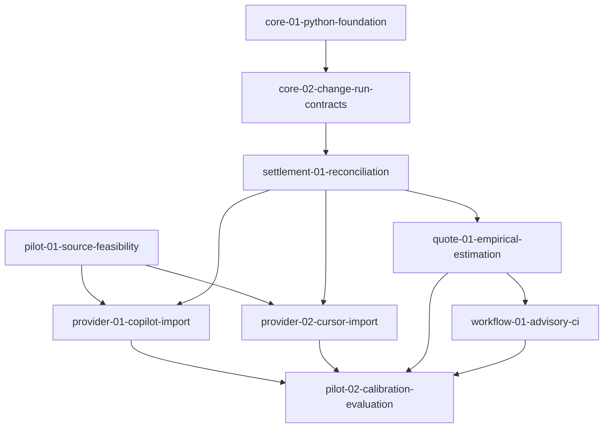

# Pilot change order and GitHub mapping

Planning baseline: **2026-09-28 (Europe/Berlin)**; lifecycle reconciled **2026-09-29**.
The Python foundation and supplemental bounded-review workflow are delivered and
archived. Source-feasibility research is partly implemented; its remaining inspection
tasks keep it active despite closed #9. Core-02 (#11) merged in PR #25 and is
archived with synchronized main specs. Settlement reconciliation implementation was authorized on 2026-09-29 and is
in progress; provider implementation and live collection require a subsequent request.

Supplemental contributor workflow: [#23](https://github.com/nold-ai/changecost/issues/23)
tracks the delivered/archived [dev-workflow-01-bounded-review](changes/archive/2026-09-29-dev-workflow-01-bounded-review/proposal.md), a development-only control for retaining
review context and bounding correction loops. It is a sub-issue of [#6](https://github.com/nold-ai/changecost/issues/6), has no pilot dependency edge, and does not
change the nine-change product delivery order.

Supplemental behavioral-evidence pilot: [#26](https://github.com/nold-ai/changecost/issues/26)
tracks [dev-workflow-02-behavioral-evidence](changes/dev-workflow-02-behavioral-evidence/proposal.md),
an implementation-authorized contributor workflow under #6, published in open
[PR #27](https://github.com/nold-ai/changecost/pull/27). Its 2026-09-30 in-place
post-replan phase preserves the original pilot outcome and adds scoped recovery,
native-evidence adjudication and finite reviewer/receipt workflow obligations. Native
prerequisites are #23 and #11, delivered by merged PRs #24 and #25; #11 remains
administratively open at preparation. That discrepancy does not block the authorized
pilot on the merged lifecycle code. This story adds no dependency to the nine-change
product delivery order. Its original controls and empirical outcome are recorded; automatic coordinator
completion remains unmet until the post-replan exact-head acceptance actually passes.
This adds no new issue or product-order dependency.

- Epic: [#4](https://github.com/nold-ai/changecost/issues/4) — ChangeCost — validate change-level cost estimation and settlement.
- Organization project: [ChangeCost](https://github.com/orgs/nold-ai/projects/3) — private, linked to this repository.
- Native hierarchy: **Epic → Feature → User Story**. All 14 issues start **Todo**,
  unassigned and without delivery dates.
- Every dependency below is also a native GitHub blocked-by relationship. Arrows
  run from prerequisite to dependent; feature grouping adds no implementation gate.

## Feature groups

| Feature | Native Feature issue | Parent |
| --- | --- | --- |
| Pilot evidence | [#5](https://github.com/nold-ai/changecost/issues/5) | [#4](https://github.com/nold-ai/changecost/issues/4) |
| Local core and contracts | [#6](https://github.com/nold-ai/changecost/issues/6) | [#4](https://github.com/nold-ai/changecost/issues/4) |
| Attribution and settlement | [#7](https://github.com/nold-ai/changecost/issues/7) | [#4](https://github.com/nold-ai/changecost/issues/4) |
| Quotes and developer workflow | [#8](https://github.com/nold-ai/changecost/issues/8) | [#4](https://github.com/nold-ai/changecost/issues/4) |

## Changes in dependency order

| Change / proposal | Story | Feature | Implementation prerequisites |
| --- | --- | --- | --- |
| [pilot-01-source-feasibility](changes/pilot-01-source-feasibility/proposal.md) | [#9](https://github.com/nold-ai/changecost/issues/9) | [#5](https://github.com/nold-ai/changecost/issues/5) | None |
| [core-01-python-foundation](changes/archive/2026-09-29-core-01-python-foundation/proposal.md) | [#10](https://github.com/nold-ai/changecost/issues/10) | [#6](https://github.com/nold-ai/changecost/issues/6) | None |
| [core-02-change-run-contracts](changes/archive/2026-09-29-core-02-change-run-contracts/proposal.md) | [#11](https://github.com/nold-ai/changecost/issues/11) | [#6](https://github.com/nold-ai/changecost/issues/6) | [#10](https://github.com/nold-ai/changecost/issues/10) `core-01-python-foundation` |
| [settlement-01-reconciliation](changes/settlement-01-reconciliation/proposal.md) | [#12](https://github.com/nold-ai/changecost/issues/12) | [#7](https://github.com/nold-ai/changecost/issues/7) | [#11](https://github.com/nold-ai/changecost/issues/11) `core-02-change-run-contracts` |
| [provider-01-copilot-import](changes/provider-01-copilot-import/proposal.md) | [#13](https://github.com/nold-ai/changecost/issues/13) | [#7](https://github.com/nold-ai/changecost/issues/7) | [#9](https://github.com/nold-ai/changecost/issues/9) `pilot-01-source-feasibility`, [#12](https://github.com/nold-ai/changecost/issues/12) `settlement-01-reconciliation` |
| [provider-02-cursor-import](changes/provider-02-cursor-import/proposal.md) | [#14](https://github.com/nold-ai/changecost/issues/14) | [#7](https://github.com/nold-ai/changecost/issues/7) | [#9](https://github.com/nold-ai/changecost/issues/9) `pilot-01-source-feasibility`, [#12](https://github.com/nold-ai/changecost/issues/12) `settlement-01-reconciliation` |
| [quote-01-empirical-estimation](changes/quote-01-empirical-estimation/proposal.md) | [#15](https://github.com/nold-ai/changecost/issues/15) | [#8](https://github.com/nold-ai/changecost/issues/8) | [#12](https://github.com/nold-ai/changecost/issues/12) `settlement-01-reconciliation` |
| [workflow-01-advisory-ci](changes/workflow-01-advisory-ci/proposal.md) | [#16](https://github.com/nold-ai/changecost/issues/16) | [#8](https://github.com/nold-ai/changecost/issues/8) | [#15](https://github.com/nold-ai/changecost/issues/15) `quote-01-empirical-estimation` |
| [pilot-02-calibration-evaluation](changes/pilot-02-calibration-evaluation/proposal.md) | [#17](https://github.com/nold-ai/changecost/issues/17) | [#5](https://github.com/nold-ai/changecost/issues/5) | [#13](https://github.com/nold-ai/changecost/issues/13) `provider-01-copilot-import`, [#14](https://github.com/nold-ai/changecost/issues/14) `provider-02-cursor-import`, [#15](https://github.com/nold-ai/changecost/issues/15) `quote-01-empirical-estimation`, [#16](https://github.com/nold-ai/changecost/issues/16) `workflow-01-advisory-ci` |

## Dependency graph

The graph is acyclic. Source feasibility and Python foundation can start independently
once separately authorized. Contracts enable reconciliation; both provider adapters
also require the feasibility gate. Quotes depend on reconciliation and can use
synthetic evidence before provider integration. Evaluation requires both adapters,
quotes and advisory workflow; its report must expose unavailable capabilities.

## Evidence and lifecycle rules

On 2026-09-28, the maintainer extended `pilot-01-source-feasibility` research to
Codex and Claude Code CLI/IDE/app metrics and authorized inspection of existing
local artifacts. [The report](../docs/providers/source-feasibility.md) records
partial Codex/Claude observations and pending Copilot/Cursor export inspection.
PR [#21](https://github.com/nold-ai/changecost/pull/21) merged on 2026-09-28 and
GitHub issue #9 is now closed. Tasks 2.1/2.2 still record incomplete source inspection;
issue closure does not establish provider compatibility or waive those evidence gates.
This research adds no adapter story or dependency edge.
New Codex/Claude adapters need their own subsequent scope and implementation request.
The maintainer also supplied Enterprise Cursor/Copilot schema projections for
comparison; their partial findings do not establish native OTel/CSV support or
change the personal-account adapter scope.

`core-01-python-foundation` also owns executable local/pre-commit/CI parity,
documentation ownership/source consistency, generated llms/command integrity,
changelog/version coherence and workflow validation. These are prerequisites for
the implementation chain, not deferred to product budget reporting. The later
`workflow-01-advisory-ci` reuses those gates for its CLI examples and job summary;
only budget policy is advisory. This clarification changes no dependency edges.
The foundation merged in [PR #22](https://github.com/nold-ai/changecost/pull/22)
on 2026-09-28; #10 is closed. Final hosted checks and the maintainer's four explicit
accepted-risk dispositions are recorded in its
[archived tasks](changes/archive/2026-09-29-core-01-python-foundation/tasks.md).
The bounded-review helper merged in [PR #24](https://github.com/nold-ai/changecost/pull/24)
on 2026-09-29; #23 is closed. Its optional calibration remains unvalidated/not adopted,
and its legacy receipt limitations remain documented. Neither archive claims those
limitations were remediated.

Both changes were archived with OpenSpec CLI 1.13.2 on 2026-09-29, synchronizing
[python-foundation](specs/python-foundation/spec.md) and
[bounded-review-session](specs/bounded-review-session/spec.md) into main specs.
Core-02 merged in [PR #25](https://github.com/nold-ai/changecost/pull/25) on
2026-09-29 at `999cb8f960785fe4ac0434d41a0892beca933191`. All 15 tasks are complete;
`openspec archive core-02-change-run-contracts --yes` synchronized its 18 requirements
into [change-run-contracts](specs/change-run-contracts/spec.md) and archived the change.
Readback verified the full requirement blocks and retained metadata.
Seven active changes remain. Next is **settlement-01-reconciliation (#12)**;
its Core-02 implementation prerequisite is delivered. The prepared artifacts were carried directly onto `codex/settlement-01-reconciliation`
for the authorized implementation. It is local/unpublished and under verification;
no provider support is delivered.
See the [settlement preparation evidence](changes/settlement-01-reconciliation/PREPARATION_EVIDENCE.md);
the maintainer confirmed that all pilot changes remain in unreleased 0.x. The plan
evolves the existing internal schema without a public v2 compatibility programme.
See archived [implementation evidence](changes/archive/2026-09-29-core-02-change-run-contracts/TDD_EVIDENCE.md).

GitHub readback on 2026-09-29 found #11 open and #12 closed/Done, despite #11 being
implemented and #12 unimplemented. Preparation reopened #12 and restored its private project item to Todo; readback
confirmed both on 2026-09-29. #11 remains open as an administrative discrepancy
despite verified code delivery. These issue states do not prove settlement delivery.
Native dependency and hierarchy edges remain unchanged.

Provider-specific mappings remain blocked until feasibility records inspected source
profiles. Completing feasibility with an unavailable capability does not authorize
inventing support; wholly unavailable sources require an explicit scope revision.
Planning all changes together does not waive these implementation prerequisites.

Portable records use `changecost/v1`; economic units and billing bases remain separate.
The estimator's nearest-rank method, minimum sample default and cohort backoff are
specified in its design. These are reviewable pilot defaults, not validated accuracy
claims. See [source assessment](../docs/research/pilot-source-assessment.md).

Keep reciprocal issue/proposal links and native GitHub relationships aligned when
scope changes. Do not close these implementation stories when the planning PR merges.
Follow [GitHub governance](../docs/agent-rules/60-github-change-governance.md). No hierarchy
cache, release infrastructure or runtime framework is introduced.

## Delivery checks and rollback

Required planning checks: strict validation of all active changes and main specs, complete artifacts,
Given/When/Then scenario coverage, accurate task status with unfinished tasks unchecked,
valid relative links, acyclic graph,
and GitHub readback of all 14 native types, parents, dependencies, labels, private project
membership and Todo status. Preserve repository description, privacy and topics,
including `token-economics`. Runtime tests and product review are not planning evidence.

Rollback: revert the planning commit and close abandoned issues/project while preserving
history. No installed package, collected data or deployed infrastructure is changed.
