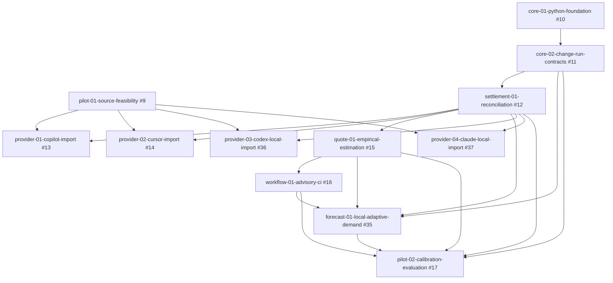

# Pilot change order and GitHub mapping

Planning baseline: **2026-09-28 (Europe/Berlin)**; lifecycle reconciled **2026-10-07**.
The Python foundation and supplemental bounded-review workflow are delivered and
archived. Source-feasibility tooling is delivered; remaining capability-reconciliation/review
tasks keep #9 active and In Progress under the 2026-10-07 closeout revision. Core-02 (#11) merged in PR #25 and is
archived with synchronized main specs. Settlement reconciliation merged in PR #28
on 2026-10-02 and is accepted/archived with synchronized main specs. Provider
implementation and live collection require a subsequent request.

Supplemental contributor workflow: [#23](https://github.com/nold-ai/changecost/issues/23)
tracks the delivered/archived [dev-workflow-01-bounded-review](changes/archive/2026-09-29-dev-workflow-01-bounded-review/proposal.md), a development-only control for retaining
review context and bounding correction loops. It is a sub-issue of [#6](https://github.com/nold-ai/changecost/issues/6), has no pilot dependency edge, and does not
change the original nine-change product delivery order; the 2026-10-07 adaptive expansion below is separate.

Supplemental behavioral-evidence pilot: [#26](https://github.com/nold-ai/changecost/issues/26)
tracks [dev-workflow-02-behavioral-evidence](changes/dev-workflow-02-behavioral-evidence/proposal.md),
a contributor workflow under #6, merged in
[PR #27](https://github.com/nold-ai/changecost/pull/27). Its 2026-09-30 in-place
post-replan phase preserves the original pilot outcome and adds scoped recovery,
native-evidence adjudication and finite reviewer/receipt workflow obligations. Native
prerequisites are #23 and #11, delivered by merged PRs #24 and #25; #11 remains
administratively open at preparation. That discrepancy does not block the authorized
pilot on the merged lifecycle code. This story adds no dependency to the nine-change
product delivery order. Its original controls and empirical outcome are recorded; automatic coordinator
completion remains unmet until the post-replan exact-head acceptance actually passes.
This adds no new issue or product-order dependency.

Supplemental risk-first execution proposal: [#40](https://github.com/nold-ai/changecost/issues/40)
tracks [dev-workflow-03-risk-first-execution](changes/dev-workflow-03-risk-first-execution/proposal.md)
under [Local core and contracts #6](https://github.com/nold-ai/changecost/issues/6).
Its sole native blocked-by prerequisite is delivered/closed #26. The guidance
adds early critical-assumption proof, evidence-based triage and one bounded
trial within existing review slots. It preserves quality gates, receipt schemas,
budgets and historical #26 limitations; it adds no product-delivery dependency.
The 2026-10-08 implementation/verification request authorizes guidance and a
verified feature push; artifacts are local until publication is verified. Trial
and final acceptance remain pending; native User Story tracking is In Progress,
unassigned and undated in the private ChangeCost project. Guidance is implemented locally; final verification/publication and the separately
authorized trial remain pending.

- Epic: [#4](https://github.com/nold-ai/changecost/issues/4) — ChangeCost — validate change-level cost estimation and settlement.
- Organization project: [ChangeCost](https://github.com/orgs/nold-ai/projects/3) — private, linked to this repository.
- Native hierarchy: **Epic → Feature → User Story**. The original 14 issues started **Todo**,
  unassigned and without delivery dates.
- Every dependency below is also a native GitHub blocked-by relationship. Arrows
  run from prerequisite to dependent; feature grouping adds no implementation gate.

## Feature groups

| Feature | Native Feature issue | Parent |
| --- | --- | --- |
| Pilot evidence | [#5](https://github.com/nold-ai/changecost/issues/5) | [#4](https://github.com/nold-ai/changecost/issues/4) |
| Local core and contracts | [#6](https://github.com/nold-ai/changecost/issues/6) | [#4](https://github.com/nold-ai/changecost/issues/4) |
| Attribution and settlement | [#7](https://github.com/nold-ai/changecost/issues/7) | [#4](https://github.com/nold-ai/changecost/issues/4) |
| Quotes and developer workflow | [#8](https://github.com/nold-ai/changecost/issues/8) | [#4](https://github.com/nold-ai/changecost/issues/4) |

## Changes in dependency order

| Change / proposal | Story | Feature | Implementation prerequisites |
| --- | --- | --- | --- |
| [pilot-01-source-feasibility](changes/archive/2026-10-08-pilot-01-source-feasibility/proposal.md) | [#9](https://github.com/nold-ai/changecost/issues/9) | [#5](https://github.com/nold-ai/changecost/issues/5) | None |
| [core-01-python-foundation](changes/archive/2026-09-29-core-01-python-foundation/proposal.md) | [#10](https://github.com/nold-ai/changecost/issues/10) | [#6](https://github.com/nold-ai/changecost/issues/6) | None |
| [core-02-change-run-contracts](changes/archive/2026-09-29-core-02-change-run-contracts/proposal.md) | [#11](https://github.com/nold-ai/changecost/issues/11) | [#6](https://github.com/nold-ai/changecost/issues/6) | [#10](https://github.com/nold-ai/changecost/issues/10) `core-01-python-foundation` |
| [settlement-01-reconciliation](changes/archive/2026-10-02-settlement-01-reconciliation/proposal.md) | [#12](https://github.com/nold-ai/changecost/issues/12) | [#7](https://github.com/nold-ai/changecost/issues/7) | [#11](https://github.com/nold-ai/changecost/issues/11) `core-02-change-run-contracts` |
| [provider-01-copilot-import](changes/provider-01-copilot-import/proposal.md) | [#13](https://github.com/nold-ai/changecost/issues/13) | [#7](https://github.com/nold-ai/changecost/issues/7) | [#9](https://github.com/nold-ai/changecost/issues/9) `pilot-01-source-feasibility`, [#12](https://github.com/nold-ai/changecost/issues/12) `settlement-01-reconciliation` |
| [provider-02-cursor-import](changes/provider-02-cursor-import/proposal.md) | [#14](https://github.com/nold-ai/changecost/issues/14) | [#7](https://github.com/nold-ai/changecost/issues/7) | [#9](https://github.com/nold-ai/changecost/issues/9) `pilot-01-source-feasibility`, [#12](https://github.com/nold-ai/changecost/issues/12) `settlement-01-reconciliation` |
| [quote-01-empirical-estimation](changes/archive/2026-10-04-quote-01-empirical-estimation/proposal.md) | [#15](https://github.com/nold-ai/changecost/issues/15) | [#8](https://github.com/nold-ai/changecost/issues/8) | [#12](https://github.com/nold-ai/changecost/issues/12) `settlement-01-reconciliation` |
| [workflow-01-advisory-ci](changes/archive/2026-10-06-workflow-01-advisory-ci/proposal.md) | [#16](https://github.com/nold-ai/changecost/issues/16) | [#8](https://github.com/nold-ai/changecost/issues/8) | [#15](https://github.com/nold-ai/changecost/issues/15) `quote-01-empirical-estimation` |
| [forecast-01-local-adaptive-demand](changes/forecast-01-local-adaptive-demand/proposal.md) | [#35](https://github.com/nold-ai/changecost/issues/35) | [#8](https://github.com/nold-ai/changecost/issues/8) | [#11](https://github.com/nold-ai/changecost/issues/11), [#12](https://github.com/nold-ai/changecost/issues/12), [#15](https://github.com/nold-ai/changecost/issues/15), [#16](https://github.com/nold-ai/changecost/issues/16); native lanes require applicable approved readers/policies |
| [provider-03-codex-local-import](changes/provider-03-codex-local-import/proposal.md) | [#36](https://github.com/nold-ai/changecost/issues/36) | [#7](https://github.com/nold-ai/changecost/issues/7) | [#9](https://github.com/nold-ai/changecost/issues/9), [#12](https://github.com/nold-ai/changecost/issues/12) |
| [provider-04-claude-local-import](changes/provider-04-claude-local-import/proposal.md) | [#37](https://github.com/nold-ai/changecost/issues/37) | [#7](https://github.com/nold-ai/changecost/issues/7) | [#9](https://github.com/nold-ai/changecost/issues/9), [#12](https://github.com/nold-ai/changecost/issues/12) |
| [pilot-02-calibration-evaluation](changes/pilot-02-calibration-evaluation/proposal.md) | [#17](https://github.com/nold-ai/changecost/issues/17) | [#5](https://github.com/nold-ai/changecost/issues/5) | [#11](https://github.com/nold-ai/changecost/issues/11), [#12](https://github.com/nold-ai/changecost/issues/12), [#15](https://github.com/nold-ai/changecost/issues/15), [#16](https://github.com/nold-ai/changecost/issues/16), [#35](https://github.com/nold-ai/changecost/issues/35); native adapters are lane-specific |

## Dependency graph

The graph is acyclic. Source feasibility and Python foundation can start independently
once separately authorized. Contracts enable reconciliation; both provider adapters
also require the feasibility gate. Quotes depend on reconciliation and can use
synthetic evidence before provider integration. Evaluation now requires delivered core, quotes/advisory and adaptive demand;
each native lane requires its approved reader/policy. Reports expose unavailable capabilities.

## Evidence and lifecycle rules

On 2026-09-28, the maintainer extended `pilot-01-source-feasibility` research to
Codex and Claude Code CLI/IDE/app metrics and authorized inspection of existing
local artifacts. [The report](../docs/providers/source-feasibility.md) records
partial Codex/Claude observations and pending Copilot/Cursor export inspection.
PR [#21](https://github.com/nold-ai/changecost/pull/21) merged on 2026-09-28 and
GitHub issue #9 was closed after that partial research, then reopened on 2026-10-03
for the authorized verified-profile closeout. Tasks 2.1/2.2 still record incomplete source inspection;
issue closure does not establish provider compatibility or waive those evidence gates.
This research adds no adapter story or dependency edge.
New Codex/Claude adapters need their own subsequent scope and implementation request.
The maintainer also supplied Enterprise Cursor/Copilot schema projections for
comparison; their partial findings do not establish native OTel/CSV support or
change the personal-account adapter scope.

`core-01-python-foundation` also owns executable local/pre-commit/CI parity,
documentation ownership/source consistency, generated llms/command integrity,
changelog/version coherence and workflow validation. These are prerequisites for
the implementation chain, not deferred to product budget reporting. The later
`workflow-01-advisory-ci` reuses those gates for its CLI examples and job summary;
only budget policy is advisory. This clarification changes no dependency edges.
The foundation merged in [PR #22](https://github.com/nold-ai/changecost/pull/22)
on 2026-09-28; #10 is closed. Final hosted checks and the maintainer's four explicit
accepted-risk dispositions are recorded in its
[archived tasks](changes/archive/2026-09-29-core-01-python-foundation/tasks.md).
The bounded-review helper merged in [PR #24](https://github.com/nold-ai/changecost/pull/24)
on 2026-09-29; #23 is closed. Its optional calibration remains unvalidated/not adopted,
and its legacy receipt limitations remain documented. Neither archive claims those
limitations were remediated.

Both changes were archived with OpenSpec CLI 1.13.2 on 2026-09-29, synchronizing
[python-foundation](specs/python-foundation/spec.md) and
[bounded-review-session](specs/bounded-review-session/spec.md) into main specs.
Core-02 merged in [PR #25](https://github.com/nold-ai/changecost/pull/25) on
2026-09-29 at `999cb8f960785fe4ac0434d41a0892beca933191`. All 15 tasks are complete;
`openspec archive core-02-change-run-contracts --yes` synchronized its 18 requirements
into [change-run-contracts](specs/change-run-contracts/spec.md) and archived the change.
Readback verified the full requirement blocks and retained metadata.
Settlement reconciliation merged in [PR #28](https://github.com/nold-ai/changecost/pull/28)
on 2026-10-02 at `1f55b767066d9834765f92a427b5eb9dc653a315`. The maintainer accepted
closeout and CLI archival on 2026-10-02. All 19 tasks are complete against the
[final merged verification index](changes/archive/2026-10-02-settlement-01-reconciliation/TDD_EVIDENCE.md#implementation-acceptance-and-archive-closeout--2026-10-02-europeberlin).
`openspec archive settlement-01-reconciliation --yes` (CLI 1.13.2) synchronized
three added [contract requirements](specs/change-run-contracts/spec.md) and fourteen
added [reconciliation requirements](specs/evidence-reconciliation/spec.md), then
archived the change. Readback preserved all 17 requirement bodies, 55 scenarios,
the 18 prior contract requirements and metadata. The CLI collapses an extra blank
line; no requirement or scenario content changed.

The selected next work is **pilot-01-source-feasibility (#9)**: the maintainer
reopened it on 2026-10-03 for verified native profiles and executable closeout
checks. Provider **#13**, then **#14**, retain their approved dependency order;
#9 remains open pending reviewed capability dispositions and reconciliation;
  supported mappings still require independent native approval.
Settlement is delivered. Quotes **#15** were prepared earlier on 2026-10-03 and
subsequently implemented and merged in [PR #32](https://github.com/nold-ai/changecost/pull/32).
Its accepted contract was synchronized through the native OpenSpec CLI in this
worktree on 2026-10-04; the archive remains local/unpublished. Neither synthetic Quote coverage nor settlement acceptance
approves provider imports or live collection. Provider implementation still
requires a subsequent request.
See the [historical settlement preparation evidence](changes/archive/2026-10-02-settlement-01-reconciliation/PREPARATION_EVIDENCE.md)
and [accepted implementation evidence](changes/archive/2026-10-02-settlement-01-reconciliation/TDD_EVIDENCE.md). All pilot changes
remain the first unreleased 0.x product; no public v2 compatibility programme is
introduced. The supplemental behavioral workflow remains active pending its own
lifecycle closeout; this settlement request does not archive it.

GitHub readback on 2026-09-29 found #11 open and #12 closed/Done, despite #11 being
implemented and #12 unimplemented. Preparation reopened #12 and restored its private project item to Todo; readback
confirmed both on 2026-09-29. #11 remains open as an administrative discrepancy
despite verified code delivery. That readback is historical. On 2026-10-02, #12
is CLOSED/Done after merged PR #28; its User Story type, parent #7, prerequisite
#11 and labels are retained. Fresh readback on 2026-10-03 confirms #11 CLOSED
since 2026-10-02 at 23:53:45 Europe/Berlin; no prerequisite issue mutation is
needed in this settlement closeout. Native dependency and hierarchy edges remain unchanged.

Provider-specific mappings remain blocked until feasibility records inspected source
profiles. Completing feasibility with an unavailable capability does not authorize
inventing support; wholly unavailable sources require an explicit scope revision.
Planning all changes together does not waive these implementation prerequisites.

Portable records use `changecost/v1`; economic units and billing bases remain separate.
The estimator's nearest-rank method, minimum sample default and cohort backoff are
specified in its design. These are reviewable pilot defaults, not validated accuracy
claims. See [source assessment](../docs/research/pilot-source-assessment.md).

Keep reciprocal issue/proposal links and native GitHub relationships aligned when
scope changes. Do not close these implementation stories when the planning PR merges.
Follow [GitHub governance](../docs/agent-rules/60-github-change-governance.md). No hierarchy
cache, release infrastructure or runtime framework is introduced.

## Delivery checks and rollback

Required planning checks: strict validation of all active changes and main specs, complete artifacts,
Given/When/Then scenario coverage, accurate task status with unfinished tasks unchecked,
valid relative links, acyclic graph,
and GitHub readback of all **17 hierarchy issues**: Epic #4; Features #5–#8;
User Stories #9–#17 and #35–#37. Verify each issue’s native type, parent,
dependencies, labels, private project membership and current lifecycle/project
status. New unstarted stories #35–#37 remain Todo, unassigned and undated; preserve
existing delivered and In Progress states. Preserve repository description, privacy and topics,
including `token-economics`. Runtime tests and product review are not planning evidence.

Rollback: revert the planning commit and close abandoned issues/project while preserving
history. No installed package, collected data or deployed infrastructure is changed.

Quote #15 implementation was authorized and merged in PR #32 on 2026-10-03.
The synthetic-only estimator is delivered; native CLI archival on 2026-10-04
synchronized six requirements and 31 scenarios into
[empirical-quotes](specs/empirical-quotes/spec.md), preserving metadata and
[accepted evidence](changes/archive/2026-10-04-quote-01-empirical-estimation/TDD_EVIDENCE.md).
Provider approval and live calibration remain separate gates.

Source feasibility #9 was reopened on 2026-10-03 for verified native profiles and executable closeout evidence. Historical PR #21 delivered partial research; it did not approve provider imports. Provider #13/#14 retain their native #9 dependency.

## Advisory workflow preparation — 2026-10-05 (Europe/Berlin)

The maintainer selected **workflow-01-advisory-ci (#16)** after accepted Quotes #15.
[Preparation evidence](changes/archive/2026-10-06-workflow-01-advisory-ci/PREPARATION_EVIDENCE.md)
reconciles the delivered four command families/registration/outcomes against the
remaining human presentation, structured errors, read-only budget check and optional
summary example. The sole native prerequisite remains closed #15; parent #8 and
Open/Todo status are retained. Provider #13/#14 remain separate with source gates.

Imported/unverifiable producer claims return unknown with displayed declared values;
numeric advice requires supported local historical value/completeness reproduction.
Existing JSON success payloads remain intact, p90 is the default Quote comparison,
and valid advice exits zero while technical failures exit 2. Future tasks remain
unchecked. No new native edge, provider approval, live collection, runtime code,
persistence migration or public version is added.

The requested disposition is local/unpublished retention in this same worktree with
the native Quote archive for later combined delivery. No plan-only PR or stash is
created. Implementation needs a subsequent request and fresh binding/verification.

Advisory #16 implementation and combined verification/PR delivery were explicitly
authorized on 2026-10-05. Its preparation remains historical; implementation/current
acceptance evidence is retained in its archived change. The quote archive is preserved.

## Advisory archive and selected preparation — 2026-10-06 (Europe/Berlin)

This section records the historical local preparation on 2026-10-06. The
2026-10-07 publication disposition in the adaptive-demand expansion below
supersedes its then-pending PR/stash choice.

Advisory #16 merged in [PR #34](https://github.com/nold-ai/changecost/pull/34)
at `ee424b5cf3c116b18515cec1ee086e1a6de223a0` (09:41:49 Europe/Berlin).
`openspec archive workflow-01-advisory-ci --yes` (1.13.2, spec-driven)
synchronized all 11 added requirements and 69 scenarios into
[advisory-workflow](specs/advisory-workflow/spec.md). Readback preserved requirement
bodies, scenarios and metadata; the accepted Quote archive remains unchanged.
[Archived tasks](changes/archive/2026-10-06-workflow-01-advisory-ci/tasks.md)
retain unchecked task 5.2 and the maintainer's accepted quota-blocked full Codex
code-review limitation. This exception does not waive future reviews.

The selected next preparation is **pilot-01-source-feasibility (#9)**. Its offline
checker/register/18-case tooling merged in PR #33, but all 14 profiles have zero
native approvals. #9 remains Open/In Progress and #13/#14 keep blocked-by #9/#12.
Current normalized imports exist; trusted coverage/replay remains synthetic billed
USD only. See the [architecture decisions](changes/archive/2026-10-08-pilot-01-source-feasibility/design.md#preparation-decisions--2026-10-06-europeberlin)
and [current research](changes/archive/2026-10-08-pilot-01-source-feasibility/RESEARCH_EVIDENCE.md#preparation-research--2026-10-06-europeberlin).
This preparation is locally unpublished pending checks and the PR/stash choice;
provider implementation, live collection and calibration remain separate gates.

## Adaptive-demand expansion — 2026-10-07 (Europe/Berlin)

The maintainer approved three additional first-product planning stories: adaptive
demand #35 under #8, Codex local reader #36 and Claude local reader #37 under #7.
Native User Story types, parents, blocked-by edges and private project Todo state
were read back; new stories are unassigned and undated. No implementation is delivered.
The original nine-change plan and historical decisions remain evidence, not a
current universal export requirement. #9 now closes through reviewed capability
dispositions/gaps; missing optional exports/admin/Enterprise/hook sources do not
block every lane, while unsupported mappings remain unavailable.

Native #13/#14 blockers remain #9/#12. Evaluation #17 removes universal #13/#14
blockers and adds #11/#12/#35 alongside delivered #15/#16. Applicable approved
readers/policies are required for each native evaluation lane. The graph is acyclic.
Offline demand contracts/synthetic verification can proceed on delivered core;
native semantic/accounting/coverage approval then enables individual readers and
native learning. A missing provider cannot prevent another eligible source's evaluation.

See [forecasting](../docs/forecasting.md), [architecture/evidence register](../docs/research/adaptive-demand-evidence.md)
and the three proposals. Preserve the delivered Quote/advisory contracts and their
archives. The selected disposition is the published planning-only
[PR #38](https://github.com/nold-ai/changecost/pull/38), which supersedes the earlier
local-only stash choice. Both scoped stashes remain recovery points; they are not
the delivery disposition. PR publication does not imply merge or implementation
completion and preserves recorded review limits.
Native approvals remain zero. No runtime, collection, paid service or release is added.

## Source reconciliation checkpoint — 2026-10-07

PR #38 merged planning at `dc26715`; #9 now reconciles nine additional local/
inventory profiles while retaining the 14 historical objects and zero approvals.
Independent disposition review and actual delivery acceptance remain required;
missing optional source capabilities are lane-specific gaps. No prerequisite edge
changes: #13/#14/#36/#37 retain #9/#12; #35's offline synthetic phase has no #9 gate.
The source change remains active pending acceptance. The maintainer authorized
the separate `pilot-01-source-feasibility-reconcile-20261007` review session for
this post-merge diff; partial older receipt evidence is preserved. Current-scope
review and applicable Linux/publication assurance remain required, while recovery
of the historical receipt does not block this new scope.

## Accepted source feasibility — 2026-10-08 (Europe/Berlin)

[PR #39](https://github.com/nold-ai/changecost/pull/39) merged at 23:29:03
Europe/Berlin, main `755a6e1e3243eec8a73de4163d160fa0da77ff24`, with the same
file tree as reviewed head `d9dbe9512dcc2b647dc68af31ffdd84378127571`. Both
[Linux matrix jobs](https://github.com/nold-ai/changecost/actions/runs/37843823798)
and current-head Codex/CodeRabbit reviews completed. The accepted capability-based
inventory closes the research scope; all 23 profiles retain zero native approvals.

The OpenSpec CLI archived [the change](changes/archive/2026-10-08-pilot-01-source-feasibility/proposal.md),
synchronizing seven source-feasibility requirements/52 scenarios plus one bounded-review
requirement/five scenarios. Missing native accounting, finality and coverage evidence
remain per-capability gates for #13/#14/#36/#37; prerequisite edges #9/#12 are retained.
Closing feasibility does not approve imports, learning eligibility or billed money.
Earlier active/pending statements above record dated history.

The next product change is [offline adaptive demand #35](changes/forecast-01-local-adaptive-demand/proposal.md),
starting with zero-knowledge contracts and synthetic verification. Provider readers,
live collection and native calibration remain independently authorized work.

## Focused Codex test release, 2026-10-11

Offline #35 is authorized and locally implemented; acceptance remains pending.
The conditional packaged private-alpha path is #35 → #36 → #17 → a separately
tracked release-readiness change. #35 closes through offline contracts and synthetic
checks; it does not depend on native comparison results. Prepare #17's protocol
before collecting evaluated outcomes. Native #36 must independently satisfy its
version-specific accounting gates. Copilot #13, Cursor #14 and Claude #37 can follow.
This plan authorizes no publication or release version bump.
